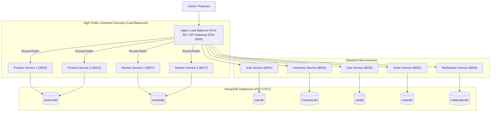

# Cloud-Native E-Commerce Microservices Architecture

A distributed, production-ready e-commerce backend built with **Node.js**, **Express**, **MongoDB**, **Docker Compose**, and an **API Gateway** implementing **JWT Authentication**, **Role-Based Access Control (RBAC)**, and **Round-Robin Load Balancing**.

---

## 🏛️ System Architecture

All client requests can route either through **Nginx Load Balancer** on Port `80` (production HTTP entry) or the **API Gateway** on Port `8000`. Nginx performs high-performance round-robin load balancing across clustered microservice replicas.




---

## 👥 Service Breakdown & Responsibilities

| Role | Service | Port | Database | Responsibilities |
| :--- | :--- | :--- | :--- | :--- |
| **Load Balancer** | **Nginx** | `80` | N/A | Production reverse proxy, upstream health, high-throughput round-robin load balancing. |
| **API Gateway** | **Gateway Service** | `8000` | N/A | Centralized microservice routing and developer proxy. |
| **Core** | **Auth Service** | `8001` | `userdb` | User registration, login, bcrypt hashing, JWT issuance. |
| **Member 1** | **Product Catalog** | `8003` & `8013` | `productdb` | Product listings, CRUD items, multi-instance load balancing. |
| **Member 1** | **Inventory Service** | `8004` | `inventorydb` | Stock quantities, low stock detection, stock deduction. |
| **Member 2** | **Cart Service** | `8005` | `cartdb` | Add/remove items, update quantities, calculate cart totals. |
| **Member 2** | **Order Service** | `8002` | `orderdb` | Order placement, user order history. |
| **Member 3** | **Review & Rating Service** | `8007` & `8017` | `reviewdb` | Product reviews, 1-5 star ratings, aggregated statistics, multi-instance load balancing. |
| **Member 3** | **Notification Service** | `8008` | `notificationdb` | Order confirmation dispatch, status updates, email simulation engine. |

---

## 🚀 Key Architectural Highlights

1. **Production-Grade Nginx Load Balancer**
   * Nginx listens on **Port 80** with configured `upstream` blocks for high-traffic clusters.
   * **Product Catalog Cluster**: `product-service-1:8003` and `product-service-2:8003`.
   * **Review & Rating Cluster**: `review-service-1:8007` and `review-service-2:8007`.
   * Adds `X-Load-Balancer: Nginx` and `X-Upstream-Server` response headers for transparent instance tracking.
2. **Fully Distributed Docker Containerization**
   * Every microservice + Nginx contains its own `Dockerfile` using lightweight Alpine images.
   * Root `docker-compose.yml` orchestrates all 10 containers, networks, and persistent MongoDB volumes.
3. **JWT Authentication & Complete RBAC**
   * Centralized JWT verification (`verifyToken`) and role validation (`requireRole('Admin')` / `requireRole('Customer')`).
   * Ownership checks: Customers can only modify/delete their own reviews, carts, and notifications.
4. **Database Connectivity & Full CRUD**
   * Schema validation, structured Mongoose models, and complete Create, Read, Update, Delete across all services.

---

## 🛠️ Quick Start Guide

### Prerequisites
* [Docker](https://www.docker.com/) & Docker Compose
* [Node.js](https://nodejs.org/) v20+ (if running without Docker)
* [Postman](https://www.postman.com/)

### Running with Docker Compose (Recommended)
```bash
# Clone the repository
git clone https://github.com/SaruonSopheakdey/ecommerce-project.git
cd ecommerce-project

# Build and start all services in detached mode
docker compose up -d --build

# Check running containers status
docker compose ps
```

All microservices will be live and accessible via the API Gateway:
`http://localhost:8000` (or `http://<EC2-PUBLIC-IP>:8000`).

---

## 📡 API Endpoints Reference

### 1. API Gateway
| Method | Route | Description | Auth |
| :--- | :--- | :--- | :--- |
| `GET` | `/health` | System health and route inspection | Public |

### 2. Auth Service (`/api/auth`)
| Method | Route | Description | Payload |
| :--- | :--- | :--- | :--- |
| `POST` | `/api/auth/register` | Register new user | `{"email": "...", "password": "...", "role": "Customer"\|"Admin"}` |
| `POST` | `/api/auth/login` | Login and receive JWT | `{"email": "...", "password": "..."}` |

### 3. Product Catalog Service (`/api/products`)
| Method | Route | Description | Auth / Role |
| :--- | :--- | :--- | :--- |
| `GET` | `/api/products` | Get all products | Bearer Token |
| `POST` | `/api/products` | Create product | Bearer Token (Admin) |

### 4. Inventory Service (`/api/inventory`)
| Method | Route | Description | Auth / Role |
| :--- | :--- | :--- | :--- |
| `POST` | `/api/inventory` | Initialize stock for a product | Bearer Token (Admin) |
| `GET` | `/api/inventory` | View all stock items | Bearer Token |
| `GET` | `/api/inventory/:productId` | View product stock level & status | Public / Bearer |
| `PUT` | `/api/inventory/:productId` | Update stock quantity | Bearer Token (Admin) |
| `POST` | `/api/inventory/:productId/deduct` | Deduct stock on order checkout | Bearer Token |
| `DELETE` | `/api/inventory/:productId` | Remove inventory item | Bearer Token (Admin) |

### 5. Cart Service (`/api/cart`)
| Method | Route | Description | Auth / Role |
| :--- | :--- | :--- | :--- |
| `GET` | `/api/cart` | View current user's cart | Bearer Token (Customer) |
| `POST` | `/api/cart/items` | Add item or increment quantity | Bearer Token (Customer) |
| `PUT` | `/api/cart/items/:productId`| Update item quantity (0 removes item) | Bearer Token (Customer) |
| `DELETE` | `/api/cart/items/:productId`| Remove specific item from cart | Bearer Token (Customer) |
| `DELETE` | `/api/cart` | Clear entire cart | Bearer Token (Customer) |
| `GET` | `/api/cart/user/:userId` | View user cart | Bearer Token (Admin / Owner) |

### 6. Order Service (`/api/orders`)
| Method | Route | Description | Auth / Role |
| :--- | :--- | :--- | :--- |
| `POST` | `/api/orders` | Place a new order | Bearer Token |
| `GET` | `/api/orders` | View order history | Bearer Token |

### 7. Review & Rating Service (`/api/reviews` - Load Balanced)
| Method | Route | Description | Auth / Role |
| :--- | :--- | :--- | :--- |
| `POST` | `/api/reviews` | Post review & rating (1-5) | Bearer Token (Customer) |
| `GET` | `/api/reviews` | View all reviews (`?productId=` / `?userId=`) | Public |
| `GET` | `/api/reviews/product/:productId` | Reviews for product + average rating | Public |
| `GET` | `/api/reviews/:id` | View single review | Public |
| `PUT` | `/api/reviews/:id` | Edit review | Bearer Token (Owner Only) |
| `DELETE` | `/api/reviews/:id` | Delete review | Bearer Token (Owner / Admin) |
| `GET` | `/api/reviews/health` | Health check + load balanced instance ID | Public |

### 8. Notification & Email Service (`/api/notifications`)
| Method | Route | Description | Auth / Role |
| :--- | :--- | :--- | :--- |
| `POST` | `/api/notifications` | Send notification & trigger email dispatch | Bearer Token |
| `GET` | `/api/notifications` | View notifications (Customer=own, Admin=all) | Bearer Token |
| `GET` | `/api/notifications/user/:userId` | View user notifications | Bearer Token (Admin / Owner) |
| `GET` | `/api/notifications/:id` | View single notification | Bearer Token (Admin / Owner) |
| `PUT` | `/api/notifications/:id/read` | Mark notification as read | Bearer Token (Admin / Owner) |
| `DELETE` | `/api/notifications/:id` | Delete notification | Bearer Token (Admin / Owner) |

---

## 🧪 Testing & Verification Guide

### 1. Nginx Load Balancing Verification

#### Load Balancer Configuration (`nginx/nginx.conf`):
```nginx
# Round-robin load balancing for Product Catalog
upstream product_service_cluster {
    server product-service-1:8003;
    server product-service-2:8003;
}

# Round-robin load balancing for Review & Rating Service
upstream review_service_cluster {
    server review-service-1:8007;
    server review-service-2:8007;
}

server {
    listen 80;
    
    # Custom headers for verification
    add_header X-Load-Balancer "Nginx" always;
    add_header X-Upstream-Server $upstream_addr always;

    location /api/products {
        proxy_pass http://product_service_cluster;
    }

    location /api/reviews {
        proxy_pass http://review_service_cluster;
    }
}
```

#### Verification via Postman (Port 80 or Port 8000):
Send consecutive `GET` requests to the Nginx Load Balancer:
```http
GET http://localhost/api/reviews/health
```
*(On EC2, use `http://<EC2-PUBLIC-IP>/api/reviews/health` on default HTTP Port 80)*

* **Request 1**:
  * Response Header: `X-Load-Balancer: Nginx`
  * Response Header: `X-Upstream-Server: 172.x.x.x:8007` (Instance 1)
  * Response Header: `X-Served-By: review-instance-8007`
* **Request 2**:
  * Response Header: `X-Load-Balancer: Nginx`
  * Response Header: `X-Upstream-Server: 172.x.x.x:8007` (Instance 2)
  * Response Header: `X-Served-By: review-instance-8017`

And similarly for Product Catalog:
```http
GET http://localhost/api/products/health
```
* Alternates between `product-instance-8003` and `product-instance-8013`.

---

### 2. Security & RBAC Test Cases
* **Wrong Password**:
  * `POST http://localhost/api/auth/login` (or `:8000`) with incorrect password → `400 Bad Request` (`{"message": "Wrong password"}`)
* **Invalid / Expired Token**:
  * `GET http://localhost/api/reviews` with `Authorization: Bearer invalidtoken123` → `400 Bad Request` (`{"message": "Invalid or Expired Token"}`)
* **Unauthorized Role Mismatch**:
  * `POST http://localhost/api/products` using a Customer Token → `403 Forbidden` (`{"message": "Access Denied: Unauthorized Role"}`)
* **Missing Token**:
  * Any protected route without token → `401 Unauthorized` (`{"message": "Access Denied: No Token Provided"}`)

---

### 3. Inspecting MongoDB Collections
```bash
docker exec -it ecommerce-mongo mongosh
```
```javascript
use reviewdb
show collections
db.reviews.find().pretty()

use notificationdb
show collections
db.notifications.find().pretty()
```

---

## ☁️ Deployment on AWS EC2
1. Launch an **Ubuntu 24.04** instance on EC2.
2. **Security Group Inbound Rules (CRUCIAL)**:
   * **Port 22** (`SSH`, `0.0.0.0/0`) — Remote terminal access.
   * **Port 80** (`HTTP`, `0.0.0.0/0`) — **Nginx Load Balancer** entry.
   * **Port 8000** (`Custom TCP`, `0.0.0.0/0`) — **API Gateway** entry.
3. Install Docker & Compose:
   ```bash
   sudo apt update && sudo apt install -y git docker.io docker-compose-v2
   sudo usermod -aG docker $USER
   newgrp docker
   ```
4. Clone repo and run:
   ```bash
   docker compose up -d --build
   ```
5. Test against your Public IPv4 in Postman:
   * Via Nginx Load Balancer: `http://<EC2-PUBLIC-IP>/api/reviews/health`
   * Via API Gateway: `http://<EC2-PUBLIC-IP>:8000/api/reviews/health`


## Cart & Checkout (Cart Service 8005, Order Service 8006)

Owner: Chamnab Hoeum

- Cart Service: add, update and remove items, view and clear cart (Customer); view any cart (Admin)
- Order Service: checkout from cart, order history (Customer); view all orders and update status (Admin)
