# Cloud-Native E-Commerce Microservices Architecture

A distributed, production-ready e-commerce backend built with **Node.js**, **Express**, **MongoDB**, **Docker Compose**, and an **API Gateway** implementing **Centralized JWT Authentication**, **Role-Based Access Control (RBAC)**, and **Two-Tier Round-Robin Load Balancing**.

---

## 🏛️ System Architecture

The system has **one public entry point** and three clearly separated layers. Each layer has exactly one job.

| Layer | Component | Job | Reachable from outside? |
| :--- | :--- | :--- | :--- |
| 1. Edge | **Nginx** (port `80`) | Single public entry point. Round-robin load balances across the API Gateway replicas with active failover. | ✅ Yes (only port 80) |
| 2. Gateway | **API Gateway** x2 replicas (port `8000`, internal) | Routes `/api/*` to the owning service, verifies the JWT at the edge, sanitizes spoofed headers, forwards verified identity as `X-User-*` headers, and load balances product instances. | ❌ Internal only |
| 3. Services | **8 microservices** (+ 2 instances of Product Service) | Business logic. Downstream services consume verified `X-User-*` headers directly, eliminating repetitive token decoding code. | ❌ Internal only |

```
                        +-----------------------+
                        |   Postman / Client    |
                        +-----------+-----------+
                                    |  http://host:80   (the ONLY published port)
                                    v
                        +-----------------------+
                        |  Nginx (Edge / LB)    |   round-robin + failover
                        +-----------+-----------+
                          |                   |
                          v                   v
                +----------------+   +----------------+
                | Gateway #1     |   | Gateway #2     |   JWT check + identity header forwarding
                +-------+--------+   +--------+-------+
                        \_____________  _____/
                                      \/
     +-----------+-----------+--------+--------+-----------+-------------+
     |           |           |        |        |           |             |
     v           v           v        v        v           v             v
  [Auth]    [Product x2] [Inventory] [Cart]  [Order]    [Review]   [Notification]
  userdb     productdb   inventorydb cartdb  orderdb    reviewdb    notificationdb
     \___________\___________\________|________/___________/_____________/
                                  MongoDB (internal network)
```

### Visual Architecture Flow (Mermaid)

```mermaid
flowchart TD
    Client["Client / Postman"] -->|"port 80 (only public port)"| NG["Nginx - Edge Load Balancer"]

    subgraph GW ["API Gateway (internal, 2 replicas)"]
        NG -->|Round-Robin| G1["Gateway 1"]
        NG -->|Round-Robin| G2["Gateway 2"]
    end

    subgraph SVC ["Microservices (internal only)"]
        G1 & G2 --> AS["Auth (8001)"]
        G1 & G2 -->|Round-Robin| PC["Product x2 (8003 & 8006)"]
        G1 & G2 --> IS["Inventory (8004)"]
        G1 & G2 --> CS["Cart (8005)"]
        G1 & G2 --> OS["Order (8002)"]
        G1 & G2 --> RS["Review (8007)"]
        G1 & G2 --> NS["Notification (8008)"]
    end

    subgraph DB ["MongoDB (database per service)"]
        AS --> DB_A[("userdb")]
        PC --> DB_P[("productdb")]
        IS --> DB_I[("inventorydb")]
        CS --> DB_C[("cartdb")]
        OS --> DB_O[("orderdb")]
        RS --> DB_R[("reviewdb")]
        NS --> DB_N[("notificationdb")]
    end
```



**Why both Nginx and an API Gateway?**
* **Nginx (Edge Layer)**: Serves as the public-facing HTTP reverse proxy on Port 80. It handles TCP/HTTP-level connection pooling, SSL termination, and distributes traffic evenly across the API Gateway cluster with automatic health-checking and failover.
* **API Gateway (Application Layer)**: Centralizes application concerns. It verifies JWT signatures, strips client-spoofed identity headers, rejects unauthorized requests, and propagates identity (`X-User-Id`, `X-User-Role`, `X-User-Email`) down to internal services.

---

## 👥 Service Breakdown & Responsibilities

| Role | Service | Port | Database | Responsibilities |
| :--- | :--- | :--- | :--- | :--- |
| **Edge** | **Nginx** | `80` (public) | N/A | Only public entry point. Round-robin load balances gateway replicas. |
| **Gateway** | **Gateway Service** (x2) | `8000` (internal) | N/A | Routing, centralized JWT validation, header sanitization, identity injection, Product catalog load balancing. |
| **Core** | **Auth Service** | `8001` (internal) | `userdb` | User registration, login, password hashing (bcrypt), JWT generation. |
| **Member 1** | **Product Catalog** | `8003` & `8006` | `productdb` | Product catalog, CRUD operations, multi-instance load balancing. |
| **Member 1** | **Inventory Service** | `8004` (internal) | `inventorydb` | Stock tracking, low stock alerts, atomic stock deduction. |
| **Member 2** | **Cart Service** | `8005` (internal) | `cartdb` | Item management, quantity updates, cart calculation. |
| **Member 2** | **Order Service** | `8002` (internal) | `orderdb` | Order placement, user order history. |
| **Member 3** | **Review & Rating Service** | `8007` (internal) | `reviewdb` | Product reviews, ratings (1-5), average rating aggregation. |
| **Member 3** | **Notification Service** | `8008` (internal) | `notificationdb` | Email dispatch simulator, order notification logs. |

---

## 🚀 Key Architectural Highlights

1. **Single Entry Point + Zero-Trust Port Isolation**
   * Only Nginx publishes a port (`80:80`). All downstream microservices and gateways communicate strictly over the internal Docker network.
   * Prevents bypassing authentication or direct manipulation of microservice endpoints.
2. **Two-Tier Load Balancing & High Availability**
   * **Tier 1 (Nginx -> Gateway Cluster)**: Nginx round-robins requests across `gateway-service-1` and `gateway-service-2`. If one gateway goes down, Nginx automatically fails over to the surviving instance without dropping client connections.
   * **Tier 2 (Gateway -> Clustered Product Services)**: Gateways round-robin requests across `product-service-1` / `product-service-2`.
3. **Centralized Authentication (DRY Architecture)**
   * Avoids repeating `authMiddleware.js` and `jsonwebtoken` packages across 6 microservices.
   * Gateway strips external `x-user-*` headers, validates the incoming Bearer token once, and injects authenticated identity headers downstream.
4. **Role-Based Access Control (RBAC)**
   * Enforces role requirements (`Admin` vs `Customer`) at both Gateway and service level.
   * Ownership verification ensures customers can only read/edit their own orders, reviews, and carts.

---

## 🛠️ Quick Start Guide

### Prerequisites
* [Docker](https://www.docker.com/) & Docker Compose
* [Postman](https://www.postman.com/)

### Running with Docker Compose
```bash
# Build and start all services in detached mode
docker compose up -d --build

# Check running container statuses
docker compose ps
```

Everything is reachable through Nginx on Port 80 only: `http://localhost` (or `http://<EC2-PUBLIC-IP>`).

---

## 📡 API Endpoints Reference

### 1. Edge & API Gateway
| Method | Route | Description | Auth |
| :--- | :--- | :--- | :--- |
| `GET` | `/health` | Gateway health and route inspection (returns replica instance ID) | Public |
| `GET` | `/nginx-health` | Nginx edge health & upstream status | Public |

### 2. Auth Service (`/api/auth`)
| Method | Route | Description | Payload |
| :--- | :--- | :--- | :--- |
| `POST` | `/api/auth/register` | Register new user | `{"email": "...", "password": "...", "role": "Customer"\|"Admin"}` |
| `POST` | `/api/auth/login` | Login and receive JWT | `{"email": "...", "password": "..."}` |

### 3. Product Catalog Service (`/api/products`)
| Method | Route | Description | Auth / Role |
| :--- | :--- | :--- | :--- |
| `GET` | `/api/products` | Get all products | Public / Bearer |
| `POST` | `/api/products` | Create product | Bearer Token (Admin) |

### 4. Inventory Service (`/api/inventory`)
| Method | Route | Description | Auth / Role |
| :--- | :--- | :--- | :--- |
| `POST` | `/api/inventory` | Initialize stock for a product | Bearer Token (Admin) |
| `GET` | `/api/inventory` | View all stock items | Bearer Token |
| `GET` | `/api/inventory/:productId` | View product stock level & status | Public / Bearer |
| `PUT` | `/api/inventory/:productId` | Update stock quantity | Bearer Token (Admin) |
| `POST` | `/api/inventory/:productId/deduct` | Deduct stock on order checkout | Bearer Token |
| `DELETE` | `/api/inventory/:productId` | Remove inventory item | Bearer Token (Admin) |

### 5. Cart Service (`/api/cart`)
| Method | Route | Description | Auth / Role |
| :--- | :--- | :--- | :--- |
| `GET` | `/api/cart` | View current user's cart | Bearer Token (Customer) |
| `POST` | `/api/cart/items` | Add item or increment quantity | Bearer Token (Customer) |
| `PUT` | `/api/cart/items/:productId` | Update item quantity (0 removes item) | Bearer Token (Customer) |
| `DELETE` | `/api/cart/items/:productId` | Remove specific item from cart | Bearer Token (Customer) |
| `DELETE` | `/api/cart` | Clear entire cart | Bearer Token (Customer) |
| `GET` | `/api/cart/user/:userId` | View user cart | Bearer Token (Admin / Owner) |

### 6. Order Service (`/api/orders`)
| Method | Route | Description | Auth / Role |
| :--- | :--- | :--- | :--- |
| `POST` | `/api/orders` | Place a new order | Bearer Token |
| `GET` | `/api/orders` | View order history | Bearer Token |

### 7. Review & Rating Service (`/api/reviews` - Load Balanced)
| Method | Route | Description | Auth / Role |
| :--- | :--- | :--- | :--- |
| `POST` | `/api/reviews` | Post review & rating (1-5) | Bearer Token (Customer) |
| `GET` | `/api/reviews` | View all reviews (`?productId=` / `?userId=`) | Public |
| `GET` | `/api/reviews/product/:productId` | Reviews for product + average rating | Public |
| `GET` | `/api/reviews/:id` | View single review | Public |
| `PUT` | `/api/reviews/:id` | Edit review | Bearer Token (Owner Only) |
| `DELETE` | `/api/reviews/:id` | Delete review | Bearer Token (Owner / Admin) |
| `GET` | `/api/reviews/health` | Health check + load balanced instance ID | Public |

### 8. Notification & Email Service (`/api/notifications`)
| Method | Route | Description | Auth / Role |
| :--- | :--- | :--- | :--- |
| `POST` | `/api/notifications` | Send notification & trigger email dispatch | Bearer Token |
| `GET` | `/api/notifications` | View notifications (Customer=own, Admin=all) | Bearer Token |
| `GET` | `/api/notifications/user/:userId` | View user notifications | Bearer Token (Admin / Owner) |
| `GET` | `/api/notifications/:id` | View single notification | Bearer Token (Admin / Owner) |
| `PUT` | `/api/notifications/:id/read` | Mark notification as read | Bearer Token (Admin / Owner) |
| `DELETE` | `/api/notifications/:id` | Delete notification | Bearer Token (Admin / Owner) |

---

## 🧪 Testing & Verification Guide

### 1. Load Balancing Verification (Two Levels)

#### Level 1: Nginx -> Gateway Replicas
Send consecutive requests:
```http
GET http://localhost/health
```
* Response header `X-Gateway-Instance` alternates between `gateway-instance-1` and `gateway-instance-2`.
* Response header `X-Upstream-Server` alternates between the two gateway container IPs.

#### Level 2: Gateway -> Product Replicas
```http
GET http://localhost/api/products/health
```
* `X-Served-By` alternates between `product-instance-8003` and `product-instance-8006`.

**Failover Demo:**
Run `docker stop gateway-service-1`, then continue calling `http://localhost/health`. Nginx automatically routes 100% of traffic to `gateway-service-2` without downtime.

---

### 2. Security & RBAC Test Cases
* **Wrong Password**:
  * `POST http://localhost/api/auth/login` with incorrect password → `400 Bad Request` (`{"message": "Wrong password"}`)
* **Invalid / Expired Token**:
  * `POST http://localhost/api/orders` with `Authorization: Bearer invalidtoken123` → `400 Bad Request` (`{"message": "Invalid or Expired Token"}`)
* **Missing Token on Protected Route**:
  * `POST http://localhost/api/orders` without Authorization header → `401 Unauthorized` (`{"message": "Access Denied: No Token Provided"}`)
* **Unauthorized Role Mismatch**:
  * `POST http://localhost/api/products` using a Customer Token → `403 Forbidden` (`{"message": "Access Denied: Unauthorized Role"}`)

---

## ☁️ Deployment on AWS EC2
1. Launch an **Ubuntu 24.04** EC2 instance.
2. **Security Group Inbound Rules**:
   * **Port 22** (`SSH`, `0.0.0.0/0`) — Remote terminal access.
   * **Port 80** (`HTTP`, `0.0.0.0/0`) — **Nginx entrypoint** (the only application port that needs to be open).
3. Install Docker:
   ```bash
   sudo apt update && sudo apt install -y git docker.io docker-compose-v2
   sudo usermod -aG docker $USER
   newgrp docker
   ```
4. Clone and run:
   ```bash
   git clone https://github.com/SaruonSopheakdey/ecommerce-project.git
   cd ecommerce-project
   docker compose up -d --build
   ```
5. Test against your Public IPv4 in Postman or browser:
   * `http://<EC2-PUBLIC-IP>/health`
   * `http://<EC2-PUBLIC-IP>/nginx-health`
   * `http://<EC2-PUBLIC-IP>/api/reviews/health`
